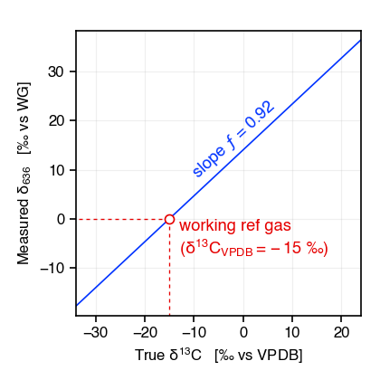

# co2stdz

Process and standardize spectroscopic analyses of CO2 isotopologues

Documentation: [https://mdaeron.github.io/co2stdz]()

# Overview

This module defines a `Dataset` object which stores some analytical data in an [pandas.DataFrame](https://pandas.pydata.org/pandas-docs/stable/reference/api/pandas.DataFrame.html). One may then standardize these data in various ways to convert “raw” measurements of the relative abundances of CO2 isotopologue into δ values corresponding to canonical metrological scales (VPDB, VSMOW) or Δ values corresponding to different isotopic anomalies (Δ17O, Δ638, Δ828).

After performing one or more standardization procedures, the `Dataset` object stores the following additional information:

* `samples`: a [DataFrame](https://pandas.pydata.org/pandas-docs/stable/reference/api/pandas.DataFrame.html) of all samples in the dataset, along with their mean raw measurements and their standardized values (along with the corresponding standard error, 95 % confidence limits, and standard deviation).
* `sessions`: a dictionary where each value is a [DataFrame](https://pandas.pydata.org/pandas-docs/stable/reference/api/pandas.DataFrame.html) of all analytical sessions in the dataset for a given quantity (e.g., `d13C_VPDB`), along with some statistics (number of anchors/unknowns in each session, instrumental correction parameters and their uncertainties).

The `Dataset` object also provides some plotting methods, such as:

* `plot_residuals()`: display analytical residuals over time
* `plot_triple_oxygen_residuals()`: plot the covariation of (δ18O, Δ17O) residuals

# Standardization approach

Converting raw measurements to standardized δ values is achieved by least-squares optimization of a “standardization model” to fit the `Dataset` observations. In this fitting procedure , each analysis carries an equal statistical weight. The parameters of the standardization model are:

* the standardized δ value (e.g., δ13CVPDB) of each unknown sample (“sample” being defined as a homogeneous material analyzed at least once in this dataset);

* the standardized δ value of the working reference gas (e.g., WGδ13C_VPDB) used in each analytical session;

* a scaling factor ƒ characterizing, for each analytical session, the ratio of observed vs true isotopic ratios between analytes and the working gas, e.g.:
  
$$
ƒ = \frac{(1+δ_{636})}{(1+\delta^{13}\text{C}_{\text{VPDB}}) / (1+{}^\text{WG}δ^{13}\text{C}_{\text{VPDB}})}
$$

Thus a dataset with *X* unknown samples analyzed in *Y* sessions for a grand total of *Z* analyses will have (*X*+2*Y*) model parameters and (*Z*-*X*-2*Y*) degrees of freedom. The standardization model is fit numerically, yielding best-fit values for each parameter as well as the (*X*+2*Y*)-by-(*X*+2*Y*) variance-covariance matrix of the best-fit parameter values, yielding standard model errors for all best-fit values (including the final, standardized δ values of all unknown samples) along with analytical error correlations between these values (samples analyzed in the same session are not statistically independent because they are jointly affected by uncertainties in that session's estimated standardization parameters).

This approach, inspired by by [*Daëron* (2021)](https://doi.org/10.1029/2020GC009592) and [*Chaillot et al.* (2025)](https://doi.org/10.1016/j.chemgeo.2024.122450), is straightforward and powerful, but like many least-squares methods it is critically sensitive to the presence of statistical outliers. It thus works well when applied to large datasets (several tens of analyses), and requires, at the very least, visual inspection of the model residuals to check for potential outliers. It also scales all model uncertainties based on the aggregate standard deviation of model residuals. It is thus (currently) not well suited to datasets in which different groups of analyses (e.g., different sessions, or different types of samples) display very different analytical repeatabilities.
